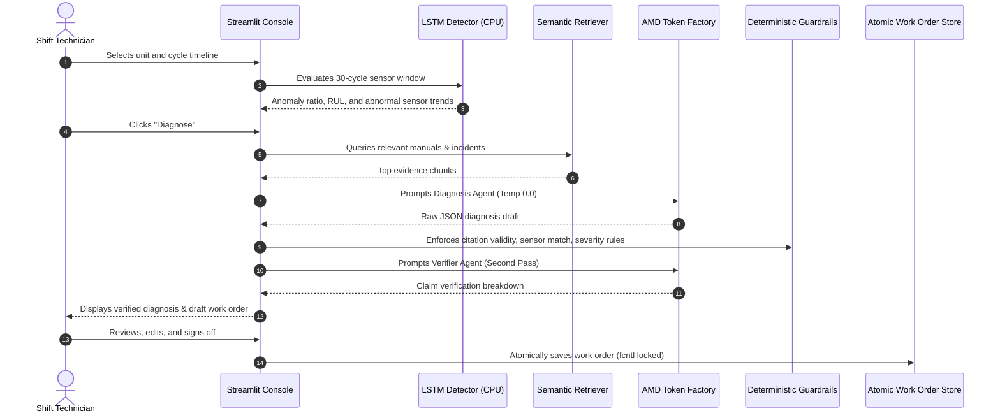

# FaultLens

[](LICENSE)
[](https://www.python.org/)
[](https://streamlit.io/)
[](https://pytorch.org/)
[](https://notebooks.amd.com/tokenfactory)
[](tests/)

**A maintenance copilot that tells a power station technician what is going wrong with a gas turbine, why, and what to do first, before it becomes a forced outage.**

Built for the **AMD Developer Hackathon ACT III**, Track 1: *Intelligent Industry*.

---

## The Problem

Gas turbines degrade slowly over hundreds of operational cycles. The warning signs are usually present in sensor telemetry dozens of cycles before an audible alarm or automatic trip, but nobody has time to monitor 14 trendlines per unit per shift and manually cross-reference them against technical manuals and years of incident archives.

When the pattern is finally noticed, it is often too late for a planned fix: what could have been a scheduled 9-hour compressor wash turns into a **31-hour forced outage** costing tens of thousands in lost generation.

```
Raw Telemetry Stream (14+ Sensors)
       │
       ▼
 [LSTM Autoencoder + RUL Predictor] ──> Anomaly Ratio & Remaining Useful Life
       │
       ▼
 [Retriever (Manuals & Incidents)]   ──> Grounded Technical Evidence
       │
       ▼
 [AMD Token Factory Reasoning]       ──> DeepSeek-V4-Flash Diagnosis
       │
       ▼
 [Code-Level Guardrails]            ──> Validates Citations, Directions & Severity
       │
       ▼
 [AMD Token Factory Verifier]        ──> Second-Pass Claim Verification
       │
       ▼
 [Interactive Operator Console]      ──> Human-in-the-Loop Work Order Approval
```

---

## What FaultLens Does

1. **Detects** degradation early using an LSTM autoencoder and a piecewise remaining-useful-life (RUL) regression model running on CPU.
2. **Explains** which sensors are abnormal, their direction, and magnitude in clear language.
3. **Retrieves Grounded Evidence**: matches sensor signatures with relevant troubleshooting manual sections (`MAN-xx`) and similar historical incidents (`INC-xxxx-xxx`).
4. **Recommends Prioritized Actions**: least invasive first (verify -> inspect -> clean/adjust -> replace), each backed by cited evidence.
5. **Enforces Code Guardrails**: deterministic code checks catch hallucinated citations, sensor code swaps, reversed directions, and unauthorized severity drops.
6. **Verifies Every Claim**: a second model pass verifies every proposed cause and action against cited text and detector readings.
7. **Drafts a Work Order**: pre-fills asset ID, priority (P1/P2/P3), estimated downtime, and required tools. A human technician reviews, edits, and approves the draft before anything is raised.

---

## Where AMD is Used

All generative reasoning and verification in the live app run on **AMD Token Factory**, AMD's hosted inference service for open models (OpenAI-compatible API).

| Pipeline Stage | Model | Role |
|---|---|---|
| **Diagnosis Agent** | `DeepSeek-V4-Flash` | Ingests detector metrics and evidence; outputs causes, actions, and work orders as strict JSON. |
| **Verifier Agent** | `DeepSeek-V4-Flash` | Second-pass validator evaluating claims against cited text and sensor observations. |
| **Model Fallback** | `DeepSeek-V4.1-Flash`, `MiMo-V2.6-Flash` | Automatically cascades down the list if the primary model encounters rate limits or timeouts. |
| **Circuit Breaker** | Code-level protection | Trips after 4 consecutive model errors to prevent request hangs during service disruptions. |

The small detector models and search index run on CPU and are committed in `artifacts/`, allowing the app to start immediately without requiring a GPU.

---

## Core Architecture & Safety Pipeline



---

## Resilience & System Design Highlights

FaultLens incorporates production-grade patterns built to industrial standards:

- **Safe Model Loading**: Model checkpoints load with `weights_only=True` to guard against arbitrary code execution.
- **Thread-Safe LLM Client**: Client initialization is thread-locked for safe multi-session concurrent access.
- **Circuit Breaker Protection**: In `app/llm.py`, repeated model timeouts trip an internal circuit breaker for 60 seconds using drift-free monotonic time, preventing frozen threads during API outages.
- **Atomic Work Order Persistence**: Disk appends use file locking (`fcntl.flock`) with unique idempotency keys (`idempotency_key`) and session deduplication, preventing race conditions or duplicate tickets.
- **In-Memory Replay Cache**: Scrubbing back to previously inspected cycles reloads results in **0 ms**, eliminating redundant Token Factory calls during demos.
- **Air-Gapped Offline Embeddings**: The vector search retriever attempts `local_files_only=True` first, starting up instantly without external Hugging Face network requests.
- **Apple HIG-Aligned UI**: Custom operations console featuring a signature dynamic severity spine, responsive sparkline snapping, legible typography, and native dark mode adaptation (`prefers-color-scheme: dark`).

---

## Quickstart

### Local Setup

```bash
# 1. Clone repository
git clone https://github.com/SyhmZlkrn/FaultLens && cd FaultLens

# 2. Configure AMD Token Factory credentials
cp .env.example .env
# Edit .env with your AMD_BASE_URL and AMD_API_KEY from notebooks.amd.com/tokenfactory

# 3. Install dependencies (CPU PyTorch keeps install light)
pip install torch --index-url https://download.pytorch.org/whl/cpu
pip install -r requirements.txt

# 4. Run the operator console
streamlit run app/ui.py
```

Get Token Factory values by signing in at [notebooks.amd.com/tokenfactory](https://notebooks.amd.com/tokenfactory). No credit card required.

### Docker Setup

```bash
docker build -t faultlens .
docker run -p 8501:8501 --env-file .env faultlens
```

Access the dashboard at `http://localhost:8501`.

---

## Verification & Retraining

Trained model checkpoints and search indexes are committed in `artifacts/`. To rebuild from scratch (takes ~2 minutes on a laptop CPU):

```bash
# Download NASA C-MAPSS FD001 dataset
python -m scripts.download_data

# Train LSTM Autoencoder and RUL Regressor
python -m scripts.train --data-dir data/raw --epochs 30

# Build semantic search index (after updating data/knowledge/)
python -m scripts.build_index

# Measure AMD Token Factory latency
python -m scripts.benchmark_llm --runs 5

# Run complete test suite (29 unit & reliability tests)
pytest -v
```

---

## How FaultLens Keeps the Model Honest

The model proposes; code enforces; a human approves.

1. **Grounded Context**: The model receives exact sensor telemetry (direction, delta, current value, z-score), window length, and retrieved manual sections.
2. **Deterministic Code Guardrails** (`app/agent.py::apply_guardrails`, `app/checks.py`):
   - All cited IDs must match provided evidence; uncited claims lower confidence and force escalation.
   - Sensor observations in the report are cross-checked against detector measurements. Renamed or inverted sensors are caught immediately.
   - Severity can only escalate (never de-escalate). Critical severity automatically enforces P1 work order priority.
   - Confidence below 0.6 triggers automatic engineer escalation.
3. **Second-Pass LLM Verifier**: A separate verifier prompt audits every claim against cited text.
4. **Mandatory Human Approval**: Work orders require an operator sign-off before being committed.

---

## Benchmark & Evaluation

Tested across 10 fixed evaluation cases (`scripts/eval_diagnosis.py`) covering both warning and critical degradation points on held-out units:

| Metric | Result |
|---|---|
| **Automated Tests** | 29 / 29 passed |
| **Model Hallucinations / Invented Citations** | 0 cases |
| **Sensor Code or Direction Mismatches** | 0 cases |
| **Critical Severity Escalation to P1** | 100% (4 / 4) |
| **Median Token Factory Latency** | ~27 s (`DeepSeek-V4-Flash`) |
| **Offline Startup Time** | < 1.5 s |

---

## Data & Safety Notes

- **Sensor Data**: NASA C-MAPSS FD001 turbofan degradation dataset, used as a realistic stand-in for gas turbine telemetry.
- **Troubleshooting Manual & Incidents**: Synthetic technical documentation in `data/knowledge/`.
- **Advisory Only**: FaultLens is strictly advisory. It never directly controls equipment or suggests bypassing interlocks, and always prompts escalation on high-risk states.

---

## License

MIT License. See [LICENSE](LICENSE) for details.
